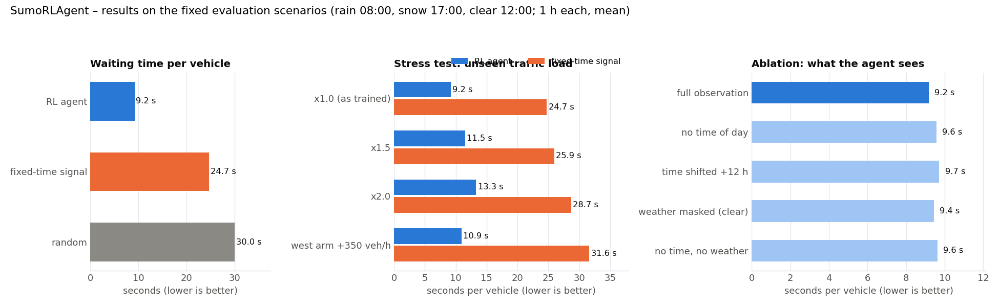
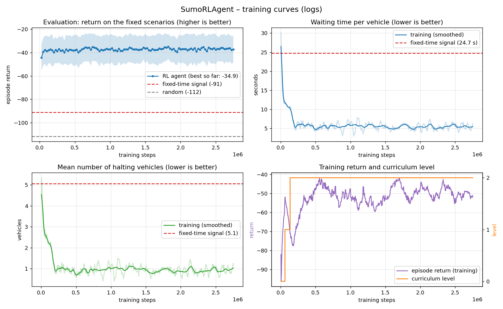

# SumoRLAgent — Weather-Aware Traffic Light Control with Reinforcement Learning

A curriculum-learning RL agent that controls a single-junction traffic light in **SUMO** (Simulation of Urban MObility).  
The agent learns to adapt phase timing to live traffic demand *and* real-world weather data (rain, snow, fog) that affect driver behaviour.

---

## Table of Contents

1. [Project Overview](#project-overview)
2. [Results](#results)
3. [Prerequisites](#prerequisites)
3. [SUMO Installation](#sumo-installation)
   - [Windows](#windows)
   - [Linux (Ubuntu / Debian)](#linux-ubuntu--debian)
   - [macOS](#macos)
4. [Setting up SUMO\_HOME](#setting-up-sumo_home)
   - [Windows (permanent)](#windows-permanent)
   - [Linux / macOS (permanent)](#linux--macos-permanent)
5. [Python Environment Setup](#python-environment-setup)
6. [Project Setup](#project-setup)
7. [Route-Dateien generieren](#route-dateien-generieren)
8. [SUMO-Dateien und ihr Zusammenspiel](#sumo-dateien-und-ihr-zusammenspiel)
9. [Running the Project](#running-the-project)
   - [Training](#training)
   - [Resuming from Checkpoint](#resuming-from-checkpoint)
   - [Evaluation](#evaluation)
   - [TensorBoard](#tensorboard)
8. [Project Structure](#project-structure)
9. [Architecture Overview](#architecture-overview)
   - [Decision cycle](#decision-cycle)
   - [Observation Space](#observation-space)
   - [Action Space](#action-space)
   - [Reward Function](#reward-function)
   - [Curriculum Learning](#curriculum-learning)
   - [Weather Model](#weather-model)
10. [Configuration Reference](#configuration-reference)
11. [Logs and Outputs](#logs-and-outputs)
12. [Troubleshooting](#troubleshooting)

---

## Project Overview

| Component | Technology |
|-----------|-----------|
| Traffic simulator | SUMO ≥ 1.19 |
| RL algorithm | MaskablePPO (sb3-contrib) |
| Curriculum | 3 levels (episode length, hours, weather), plateau-based level-up |
| Weather | Open-Meteo JSON → empirical friction/visibility model |
| Framework | PyTorch + Stable-Baselines3 |

The agent controls a 4-phase traffic light at a single cross-junction.  
Every 5 simulated seconds it selects one of 4 green phases; the `TrafficLightController` inserts the yellow / red-yellow inter-green period and enforces minimum (10 s) and maximum (60 s) green via the action mask.

---

## Results

All numbers come from one training run of **2.75 M agent decisions** (8 parallel SUMO instances, CPU only) and are measured on the three fixed scenarios in `EVAL_SCENARIOS` (rain 08:00, snow 17:00, clear 12:00; one hour each). Every policy runs the **same seeds**, so the comparison is like-for-like. Reproduce with `python env/evaluate.py`, `--stress`, `--ablation` and `python env/plot_results.py`.



### Agent vs. fixed-time signal (`logs/eval_results.json`)

| Policy | Wait per vehicle | Mean queue | Teleports | Episode return |
|--------|-----------------:|-----------:|----------:|---------------:|
| **RL agent** (`best_model.zip`) | **9.2 s** | **1.9** | 0 | **−34.9** |
| Fixed-time signal (33/10/33/10 s) | 24.7 s | 5.1 | 0 | −91.0 |
| Random (masked) | 30.0 s | 6.2 | 0 | −111.6 |

Per scenario (agent vs. fixed): rain 10.0 s vs. 23.8 s, snow 10.2 s vs. 24.6 s, clear 7.3 s vs. 25.8 s. The agent cuts the waiting time to roughly **one third** in every weather condition, with no vehicle ever teleported (no gridlock).

### Stress test: traffic the agent never saw in training (`logs/stress_results.json`)

Training uses one fixed daily demand profile. The stress test scales it with SUMO `--scale` or adds an extra one-sided flow (`STRESS_VARIANTS` in `env/config.py`, `oneJunction/routeFiles/stress_west.rou.xml`).

| Demand | Agent wait | Fixed wait | Agent queue | Fixed queue |
|--------|-----------:|-----------:|------------:|------------:|
| ×1.0 (as trained) | 9.2 s | 24.7 s | 1.9 | 5.1 |
| ×1.5 | 11.5 s | 25.9 s | 3.6 | 8.0 |
| ×2.0 | 13.3 s | 28.7 s | 5.5 | 12.0 |
| West arm +350 veh/h | 10.9 s | 31.6 s | 3.4 | 9.6 |

The advantage shrinks under double demand but stays at a factor of two or more; the asymmetric load, which a fixed cycle cannot absorb, is where the agent gains most. Hardest single case: snow at double demand, 15.4 s vs. 34.0 s.

### Ablation: which parts of the observation matter (`logs/ablation_results.json`)

Parts of the observation vector are overwritten before the policy sees them (`env/evaluate.py --ablation`).

| Observation | Wait per vehicle | Δ vs. full |
|-------------|-----------------:|-----------:|
| Full observation | 9.2 s | – |
| No time of day | 9.6 s | +0.4 s |
| Time of day shifted +12 h | 9.7 s | +0.5 s |
| Weather masked (always "clear") | 9.4 s | +0.3 s |
| No time, no weather | 9.6 s | +0.4 s |

The lane-level features (queue, waiting time, count, ETA) carry almost the whole decision. Time of day and weather are fine-tuning, and their effect is concentrated in the snow scenario (10.2 s → 11.0–11.7 s when masked). Removing them never breaks the controller, which is the intended behaviour: safety and basic performance must not depend on a weather feed being available.

### Training curves (`logs/training_plot.png`)



* **Top left** – return on the fixed evaluation scenarios every 25 k steps (mean ± std over the three scenarios); dashed lines are the fixed-time and random baselines. The agent beats the fixed-time signal after the first evaluation and plateaus at about −37 from ≈ 300 k steps; best checkpoint −34.9 at 1.825 M steps.
* **Top right / bottom left** – waiting time and queue length in the training episodes, raw and smoothed, against the fixed-time reference.
* **Bottom right** – training return and curriculum level; level 2 (3-hour episodes, any hour, weather always on) is reached after ≈ 150 k steps.

---

## Prerequisites

| Tool | Minimum version | Notes |
|------|----------------|-------|
| SUMO | 1.19.0 | `sumo`, `sumo-gui`, `traci` |
| Python | 3.10 | 3.11 / 3.12 also work |
| CUDA (optional) | 11.8 | For GPU training |
| Git | any | |

---

## SUMO Installation

### Windows

**Option A — Official installer (recommended)**

1. Go to <https://sumo.dlr.de/docs/Downloads.php#windows>
2. Download the latest **64-bit Windows installer** (e.g. `sumo-win64-1.21.0.msi`).
3. Run the installer; accept the default install path  
   (`C:\Program Files (x86)\Eclipse\Sumo`).
4. The installer adds `SUMO_HOME` to your system environment variables automatically.  
   Verify:
   ```powershell
   echo $env:SUMO_HOME
   # Expected output: C:\Program Files (x86)\Eclipse\Sumo
   ```

**Option B — Chocolatey**

```powershell
# Run PowerShell as Administrator
choco install sumo
```

**Option C — winget**

```powershell
winget install Eclipse.SUMO
```

---

### Linux (Ubuntu / Debian)

```bash
# Add the SUMO PPA
sudo add-apt-repository ppa:sumo/stable
sudo apt update
sudo apt install sumo sumo-tools sumo-gui

# Verify
sumo --version
```

For other distributions or the latest nightly build see  
<https://sumo.dlr.de/docs/Downloads.php#linux>

---

### macOS

```bash
# Using Homebrew
brew install sumo

# Verify
sumo --version
```

---

## Setting up SUMO\_HOME

`traci` (the Python API) **requires** the `SUMO_HOME` environment variable to point to the SUMO installation root (the folder that contains `bin/` and `tools/`).

### Windows (permanent)

Run **PowerShell as Administrator**:

```powershell
# Adjust the path if you chose a different install location
[System.Environment]::SetEnvironmentVariable(
    "SUMO_HOME",
    "C:\Program Files (x86)\Eclipse\Sumo",
    [System.EnvironmentVariableTarget]::Machine
)
# Add sumo/bin to PATH so you can call 'sumo' from any terminal
$oldPath = [System.Environment]::GetEnvironmentVariable("PATH","Machine")
[System.Environment]::SetEnvironmentVariable(
    "PATH",
    "$oldPath;C:\Program Files (x86)\Eclipse\Sumo\bin",
    [System.EnvironmentVariableTarget]::Machine
)
```

Close and reopen PowerShell, then verify:

```powershell
echo $env:SUMO_HOME        # → C:\Program Files (x86)\Eclipse\Sumo
sumo --version             # → SUMO 1.x.x
python -c "import traci; print('traci OK')"
```

### Linux / macOS (permanent)

Add to your shell profile (`~/.bashrc`, `~/.zshrc`, …):

```bash
export SUMO_HOME="/usr/share/sumo"          # adjust for your distro/brew path
export PATH="$SUMO_HOME/bin:$PATH"
export PYTHONPATH="$SUMO_HOME/tools:$PYTHONPATH"
```

Apply without reopening the terminal:

```bash
source ~/.bashrc   # or ~/.zshrc
```

Verify:

```bash
echo $SUMO_HOME
sumo --version
python3 -c "import traci; print('traci OK')"
```

---

## Python Environment Setup

```bash
# 1) Create a dedicated virtual environment
python -m venv .venv

# 2) Activate it
# Windows PowerShell:
.\.venv\Scripts\Activate.ps1
# Linux / macOS:
source .venv/bin/activate

# 3) Upgrade pip
pip install --upgrade pip

# 4) Install all dependencies
pip install torch torchvision torchaudio --index-url https://download.pytorch.org/whl/cu118
# (CPU-only: `pip install torch torchvision torchaudio`)

pip install stable-baselines3==2.3.2
pip install sb3-contrib==2.3.0
pip install gymnasium==0.29.1
pip install traci sumolib        # bundled with SUMO; also available on PyPI
pip install numpy pandas
pip install tensorboard rich tqdm
```

> **Note:** `traci` is also shipped inside `$SUMO_HOME/tools/`.  
> If the PyPI version conflicts, add that path to `PYTHONPATH`:
> ```bash
> export PYTHONPATH="$SUMO_HOME/tools:$PYTHONPATH"
> ```

---

## Project Setup

```bash
# Clone (or unzip) the project
git clone <repo-url> SumoRLAgent
cd SumoRLAgent

# Activate your venv (see above)

# Confirm SUMO is reachable from Python
python -c "
import os, traci
print('SUMO_HOME:', os.environ.get('SUMO_HOME'))
print('traci version:', traci.version)
"
```

No further build steps are needed — the project is pure Python.

---

## Route-Dateien generieren

> Die folgenden Dateien sind in `.gitignore` und **nicht** im Repository enthalten.  
> Sie müssen einmalig erzeugt werden bevor das Training gestartet werden kann.

| Datei | Erzeugt von | Zweck |
|-------|------------|-------|
| `routeFiles/randtrips.rou.xml` | `randomTrips.py` | Zufällige Fahrten als Input für duarouter |
| `routeFiles/oneJunction.trips.xml` | `randomTrips.py` | Alternative Trip-Datei |
| `routeFiles/baseroutes.rou.xml` | `duarouter` | Fertig geroutete Basisrouten (von `oneJunctionLearn.sumocfg` genutzt) |
| `routeFiles/baseroutes.rou.alt.xml` | `duarouter` | Alternative Routenoptionen |
| `routeFiles/merged.rou.xml` | `duarouter` | Zusammengeführte Route-Datei |

> **`routeFiles/flows.rou.xml`** ist manuell erstellt (24-Stunden-Verkehrsmodell mit stündlichen  
> Fahrzeugströmen) und **liegt bereits im Repository**. Diese Datei nicht löschen.

### Schritt 1 – Zufällige Trips erzeugen

```powershell
# Sicherstellen dass SUMO_HOME gesetzt ist
$env:SUMO_HOME = "C:\Program Files (x86)\Eclipse\Sumo"

python "$env:SUMO_HOME\tools\randomTrips.py" `
    -n oneJunction\oneJunction.net.xml `
    -o oneJunction\routeFiles\randtrips.rou.xml `
    -b 0 -e 86400 `
    --seed 42 `
    --trip-attributes "depart=`"random`" departLane=`"best`" departSpeed=`"random`""
```

Unter **Linux / macOS**:
```bash
python $SUMO_HOME/tools/randomTrips.py \
    -n oneJunction/oneJunction.net.xml \
    -o oneJunction/routeFiles/randtrips.rou.xml \
    -b 0 -e 86400 --seed 42 \
    --trip-attributes 'depart="random" departLane="best" departSpeed="random"'
```

### Schritt 2 – Routen berechnen (duarouter)

```powershell
# Windows PowerShell
duarouter `
    -n oneJunction\oneJunction.net.xml `
    -r oneJunction\routeFiles\randtrips.rou.xml `
    -o oneJunction\routeFiles\baseroutes.rou.xml `
    --ignore-errors true `
    --no-warnings true
```

```bash
# Linux / macOS
duarouter \
    -n oneJunction/oneJunction.net.xml \
    -r oneJunction/routeFiles/randtrips.rou.xml \
    -o oneJunction/routeFiles/baseroutes.rou.xml \
    --ignore-errors true --no-warnings true
```

`duarouter` erzeugt automatisch auch `baseroutes.rou.alt.xml`.

### Schritt 3 – Merged-Datei erstellen (optional)

```powershell
duarouter `
    -n oneJunction\oneJunction.net.xml `
    -r "oneJunction\routeFiles\baseroutes.rou.xml,oneJunction\routeFiles\flows.rou.xml" `
    -o oneJunction\routeFiles\merged.rou.xml `
    --ignore-errors true
```

> Nach diesen drei Schritten sind alle benötigten Dateien vorhanden und das Training kann gestartet werden.

---

## SUMO-Dateien und ihr Zusammenspiel

### Übersicht: Welche Datei macht was?

```
oneJunction/
├── oneJunction.net.xml          ← Das Straßennetz  (Kanten, Spuren, Kreuzung J13)
├── oneJunction.add.xml          ← Zusatzdatei       (Detektoren, TL-Overrides)
├── oneJunctionLearn.sumocfg     ← Startkonfiguration für Training
├── oneJunctionWeather.sumocfg   ← Startkonfiguration für Evaluation (mit Output)
├── oneJunctionRL.sumocfg        ← Startkonfiguration mit RL-spezifischen Outputs
│
├── routeFiles/
│   ├── flows.rou.xml            ← 24h-Verkehrsmodell   (manuell, stündliche Flows)
│   ├── baseroutes.rou.xml       ← Einzelfahrzeug-Routen (generiert mit duarouter)
│   ├── baseroutes.rou.alt.xml   ← Alternative Routen    (generiert mit duarouter)
│   ├── randtrips.rou.xml        ← Zufällige Trips       (generiert mit randomTrips.py)
│   ├── oneJunction.trips.xml    ← Trip-Datei            (generiert mit randomTrips.py)
│   └── merged.rou.xml           ← Zusammengeführt       (generiert mit duarouter)
│
├── trafficlightFiles/
│   └── staticTrafficlight.tll.xml  ← Statisches Ampel-Programm (Referenz)
│
└── weatherFiles/
    ├── freibergRain.json        ← Echter Wetterdatensatz (Open-Meteo API)
    ├── AlaskaSnow01_20.json
    └── …                        (11 Szenarien gesamt)
```

---

### 1. Das Netz: `oneJunction.net.xml`

Das Netz beschreibt die physische Infrastruktur der 4-Arm-Kreuzung.  
SUMO liest daraus:

- **Kanten** (edges): `-E6`, `-E7`, `-E8`, `-E9` (eingehend) / `E6`, `E7`, `E8`, `E9` (ausgehend)
- **Spuren** (lanes): je 3 Spuren pro Kante → z.B. `-E8_0`, `-E8_1`, `-E8_2`  
  (Spur 0+1 = Geradeaus/Rechts, Spur 2 = Linksabbieger)
- **Kreuzung J13**: Die einzige Ampelkreuzung; der Agent steuert ausschließlich sie
- **Verbindungen** (connections): welche Spur auf welche Ausfahrt führt

Der RL-Agent referenziert diese IDs direkt in seiner Konfiguration:

```python
config = {
    "traffic_light_id": "J13",
    "observation_lanes": ["-E8_0", "-E8_1", "-E8_2", "-E6_0", ...],
    "green_lane_map": {
        0: ["-E8_0","-E8_1","-E6_0","-E6_1"],   # N↔S Geradeaus
        1: ["-E6_2","-E8_2"],                    # N↔S Linksabbieger
        2: ["-E7_0","-E7_1","-E9_0","-E9_1"],   # O↔W Geradeaus
        3: ["-E9_2","-E7_2"],                    # O↔W Linksabbieger
    }
}
```

---

### 2. Die Ampel-Zusatzdatei: `oneJunction.add.xml`

Diese Datei erweitert die Simulation ohne das Netz zu verändern.  
Aktuell ist sie bewusst leer (nur `<!-- Detectors -->`).  
Hier könnten zukünftig hinzukommen:

- **E2-Schleifen-Detektoren** zum Messen von Staulängen
- **Ampel-Programme** (falls nicht per TraCI gesteuert)
- **Induction-Loop-Detektoren** für Fahrzeugzählungen

Das Netz hat ein eingebautes 12-Phasen-Programm (in `oneJunction.net.xml` definiert).  
Das `TrafficLightManager` überschreibt dieses Programm bei jedem Reset via TraCI:

```python
# environment.py – reset()
traci.trafficlight.setProgram("J13", "custom")   # SUMO-Programm deaktivieren
traci.trafficlight.setPhase("J13", 0)             # Agent übernimmt Kontrolle
```

Das statische Referenzprogramm in `trafficlightFiles/staticTrafficlight.tll.xml`  
(12-Phasen-Zyklus: 33 s Grün → 3 s Gelb → 6 s Grün links → 3 s Gelb …)  
kann für Baseline-Vergleiche genutzt werden, ist aber kein Teil des RL-Trainings.

---

### 3. Die `.sumocfg`-Dateien: Startkonfigurationen

Eine `.sumocfg`-Datei fasst alle Eingaben für eine Simulation zusammen.  
Beim Start via `traci.start([sumo_bin, "-c", path_to_sumocfg])` liest SUMO sie aus.

| Datei | Verwendet für | Besonderheit |
|-------|--------------|-------------|
| `oneJunctionLearn.sumocfg` | Training | Kein Output (Geschwindigkeit) |
| `oneJunctionWeather.sumocfg` | Evaluation | Schreibt `tripinfo`, `emission`, `fcd`, `queue` XML-Outputs |
| `oneJunctionRL.sumocfg` | Post-hoc-Analyse | Schreibt RL-spezifische Outputs |

Alle drei nutzen dieselben Eingaben:

```xml
<net-file   value="oneJunction.net.xml"/>
<route-files value="routeFiles/flows.rou.xml,routeFiles/baseroutes.rou.xml"/>
<additional-files value="oneJunction.add.xml"/>
<begin value="0"/>
<end   value="86400"/>
```

Im Training überschreibt `environment.py` die `--begin`- und `--end`-Zeit per  
CLI-Argument, um Episoden kürzer zu machen (Curriculum Level 0 = nur 2–4 Stunden).

---

### 4. Die Route-Dateien: Fahrzeugaufkommen

Zwei Dateien definieren gemeinsam alle Fahrzeuge in der Simulation:

#### `flows.rou.xml` – Das 24h-Verkehrsmodell

Definiert stündliche Fahrzeugströme für alle 12 Quell-Ziel-Relationen (West→Ost, West→Nord, …).  
Jede Stunde hat eigene `<flow>`-Elemente mit `vehsPerHour` und Routenwahrscheinlichkeiten:

```xml
<!-- 8 Uhr morgens, Westen → Osten: 193 Fahrzeuge/Stunde -->
<flow id="flow_west_h8" type="car" begin="28800" end="32400" vehsPerHour="193"
      depart="random" departLane="best" departSpeed="random">
  <routeDistribution>
    <route refId="W_to_E" probability="0.8"/>
    <route refId="W_to_S" probability="0.1"/>
    <route refId="W_to_N" probability="0.1"/>
  </routeDistribution>
</flow>
```

Die 12 Routen (W→E, W→S, W→N, E→W, …) sind am Anfang der Datei definiert.  
Diese Datei bildet das realistische Tagesverkehrsprofil nach (Nacht: 7–17 Fzg/h, Rush-Hour: bis 255 Fzg/h).

#### `baseroutes.rou.xml` – Einzelfahrzeug-Basisrouten

Enthält individuelle Fahrzeuge mit fixen Abfahrtszeiten und Routen,  
generiert von `duarouter` aus zufälligen Trips (`randtrips.rou.xml`).  
Dient als Grundrauschen / Grundbelastung außerhalb der Flow-Definitionen.

```xml
<vehicle id="base_0" depart="0.00">
    <route edges="-E8 E6"/>
</vehicle>
```

---

### 5. Das Wettersystem: JSON → SUMO-Fahrzeugparameter

Das Wettersystem besteht aus drei Schichten:

#### Schicht 1: Wetterdaten (Open-Meteo JSON)

Jede JSON-Datei enthält reale Stundenwerte für einen Tag:

```json
{
  "hourly": {
    "time":        ["2025-01-28T00:00", "2025-01-28T01:00", ...],
    "temperature_2m": [8.4, 7.1, ...],
    "rain":        [0.0, 0.0, ..., 1.8, 1.6, ...],
    "snowfall":    [0.0, 0.0, ...],
    "visibility":  [51320.0, 37660.0, ..., 6000.0, ...]
  }
}
```

Die 11 Szenarien umfassen z.B.:
- Freiberg Regen (Januar), Freiberg Schneefall, Freiberg Schauer  
- Jakarta Starkregen (tropisch)  
- Alaska Schnee und Regen  
- Brocken Dichtebel (Sichtweite < 50 m)

#### Schicht 2: Empirisches Reibungsmodell (`WeatherManager`)

Beim Laden der JSON-Datei berechnet `WeatherManager._create_sumo_weather_sequence()`  
für jede der 24 Stunden SUMO-Fahrzeugparameter:

```
Niederschlagstyp bestimmen:
  rain > 0  AND snow > 0  → "mixed"
  snow > 0               → "snow"
  rain > 0               → "rain"
  visibility < 1000 m    → "fog"
  sonst                  → "none"

Reibungskoeffizient:
  μ = μ_trocken (0.8)
  bei Regen:  μ -= 0.1 × √(intensität_mm)
  bei Schnee: μ -= 0.2 × √(intensität_cm×10)
  μ = max(0.1, μ × Reifeneffizienz (0.9))

Sichtfaktor:
  fog_factor = min(1.0, sichtweite_m / 1000)

Geschwindigkeitsfaktor:
  speed_factor = min(μ, fog_factor)
  → 0.1 bei dichtestem Schnee/Nebel, 1.0 bei trockenem Wetter

SUMO-Parameter:
  maxSpeed  = 13.89 m/s × speed_factor
  accel     = 2.6 m/s²  × speed_factor
  decel     = 4.5 m/s²  × speed_factor
  tau       = 1.6 s × (1 + (1 − vis_ratio))   → bis 3.2 s bei Nebel
  minGap    = 2.0 m × (1 + (1 − vis_ratio))   → bis 4.0 m bei Nebel
```

#### Schicht 3: Anwendung in der Simulation

In jedem Simulationsschritt prüft `environment.step()` ob sich die Stunde geändert hat:

```python
# environment.py – step()
hour = int((wrapped_time // 3600) % 24)
if hour != self._last_weather_hour:
    w = self.weather_manager.get_weather_for_time(wrapped_time)
    self.weather_manager.apply_weather_params(w)   # alle Fahrzeuge aktualisieren
```

`apply_weather_params()` ruft `traci.vehicle.setMaxSpeed()`, `setAccel()`,  
`setDecel()`, `setTau()`, `setMinGap()` für **jedes** Fahrzeug in der Simulation auf.  
Neu einfahrende Fahrzeuge bekommen die Parameter sofort beim Einfahren gesetzt.

#### Was der Agent beobachtet

Das Wetter fließt in 4 Beobachtungsfelder des Agenten ein:

| Feld | Dimension | Inhalt |
|------|-----------|--------|
| `precip_type` | `(5,)` | One-Hot: clear / rain / snow / mixed / fog |
| `precip_intensity` | `(1,)` | Summe aus rain + showers + snowfall×10 + snow_depth×100 |
| `visibility` | `(1,)` | Sichtweite in km |
| `friction_factor` | `(1,)` | `speed_factor` (0.1–1.0) |

Der Agent kann damit lernen, bei schlechter Sicht (längere Bremsweg) oder  
Glätte (niedrigerer Durchfluss) die Grünphasen anders zu verteilen.

---

### Zusammenfassung: Dateifluss beim Training

```
SUMO-Start (training.py)
  │
  ├─► oneJunctionLearn.sumocfg
  │     ├─► oneJunction.net.xml        (Netz: Kanten, Spuren, Kreuzung J13)
  │     ├─► oneJunction.add.xml        (Zusatzdatei: aktuell leer)
  │     └─► routeFiles/
  │           ├─ flows.rou.xml         (24h Flows: stündl. Fahrzeugströme)
  │           └─ baseroutes.rou.xml    (Einzelfahrzeuge: Basisbelastung)
  │
  ├─► TraCI-Kontrolle durch environment.py
  │     ├─ traci.trafficlight.setPhase()   (Agent wählt Grünphase)
  │     ├─ traci.vehicle.setMaxSpeed()     (Wetter wird angewendet)
  │     └─ traci.simulationStep()          (1 Sekunde simuliert)
  │
  └─► WeatherManager (pro Episode)
        ├─ zufällige JSON aus weatherFiles/ laden
        ├─ 24h Reibungsmodell berechnen
        └─ stündlich alle Fahrzeuge updaten
```

---

## Running the Project

All commands assume you are in the **project root** (the folder that contains `env/` and `oneJunction/`) and that `SUMO_HOME` is set.

### Training

```powershell
.\start_training.ps1                      # 4 parallel SUMO instances, 2 M steps
.\start_training.ps1 -NumEnvs 2 -Timesteps 500000
.\start_training.ps1 -NumEnvs 1 -Gui      # watch the agent in sumo-gui

# or directly
python env/training.py --num-envs 4 --timesteps 2000000
python env/training.py --help
```

| Flag | Default | Description |
|------|---------|-------------|
| `--num-envs` | `4` | Parallel SUMO instances (1 = no subprocesses) |
| `--timesteps` | `2_000_000` | Total agent decisions (each = 5–9 simulated seconds) |
| `--seed` | `0` | Random seed |
| `--log-dir` | `logs/` | Checkpoints, TensorBoard, curriculum state |
| `--device` | `cpu` | `cpu` is faster than `cuda` for this small MLP |
| `--resume` | off | Continue from the latest checkpoint in `--log-dir` |
| `--level` | auto | Pin the curriculum level (0–2) |
| `--eval-freq` | `25_000` | Evaluate on the fixed scenarios every N steps |
| `--gui` | off | Launch `sumo-gui` |

### Resuming from Checkpoint

```powershell
.\start_training.ps1 -Resume
# or
python env/training.py --resume
```

Loads `logs/checkpoints/maskable_ppo_<step>_steps.zip` (highest step) and `logs/curriculum_state.json`.

### Evaluation

```bash
python env/evaluate.py                       # best_model vs. fixed-time vs. random
python env/evaluate.py --model logs/final_model.zip
python env/evaluate.py --policy agent --gui  # watch the trained agent
python env/evaluate.py --stress              # demand x1.5 / x2.0 / asymmetric  -> logs/stress_results.json
python env/evaluate.py --ablation            # mask time of day / weather      -> logs/ablation_results.json
python env/plot_results.py                   # -> logs/results_plot.png
python env/plot_training.py                  # -> logs/training_plot.png (from TensorBoard logs)
```

All policies run the **same fixed scenarios** (`EVAL_SCENARIOS` in `env/config.py`: identical seed, start hour, duration and weather file), so the numbers are directly comparable:

```
policy    wait/veh [s]   queue  arrived  teleports    return
agent              9.2     1.9      742        0.0    -34.87
fixed             24.7     5.1      739        0.0    -90.99
random            30.0     6.2      734        0.0   -111.59
```

* `wait/veh` – seconds a vehicle spends halting on the approach lanes, averaged over all arrived vehicles
* `queue` – mean number of halting vehicles on the 12 approach lanes
* `return` – sum of rewards of the episode

### TensorBoard

```bash
tensorboard --logdir logs/tb_logs        # or run_tensorboard.bat
```

The curves that answer "is it learning?":

| Tag | Meaning |
|-----|---------|
| `eval/mean_reward` | Return on the fixed evaluation scenarios (higher = better; compare with the fixed-time baseline from `evaluate.py`) |
| `traffic/wait_per_vehicle` | Waiting time per vehicle in training episodes (should fall) |
| `traffic/mean_queue` | Mean queue length in training episodes (should fall) |
| `curriculum/level` | Current curriculum level |
| `curriculum/rolling_reward` | Reward per decision, rolling mean over 20 episodes |

---

## Project Structure

```
SumoRLAgent/
│
├── env/                      # RL + simulation code
│   ├── config.py             # ALL constants: paths, phases, lanes, timings, scales, curriculum, eval scenarios
│   ├── environment.py        # SumoEnvironment (gymnasium.Env) – one step = one decision
│   ├── trafficlight.py       # TrafficLightController – yellow/red-yellow, min/max green, action mask
│   ├── observer.py           # Observation vector (31 floats, normalised to [-1, 1])
│   ├── reward.py             # Bounded reward: -queue/QUEUE_SCALE - teleport penalty
│   ├── weather.py            # WeatherManager – Open-Meteo JSON → SUMO vehicle parameters
│   ├── sumo_runner.py        # Start/stop a SUMO instance via TraCI (own port + label per env)
│   ├── curriculum.py         # CurriculumManager – plateau-based level-up, JSON state
│   ├── callbacks.py          # CurriculumCallback – drives the curriculum, logs traffic metrics
│   ├── mask_utils.py         # mask_fn for sb3_contrib.ActionMasker (picklable for SubprocVecEnv)
│   ├── training.py           # Entry point: MaskablePPO training, checkpoints, resume, evaluation
│   ├── evaluate.py           # Agent vs. fixed-time vs. random; --stress, --ablation
│   ├── plot_training.py      # Training curves from TensorBoard logs -> logs/training_plot.png
│   └── plot_results.py       # Evaluation / stress / ablation bars -> logs/results_plot.png
│
├── oneJunction/              # SUMO scenario files
│   ├── oneJunction.net.xml   # Road network incl. 12-phase program "custom" for J13
│   ├── oneJunctionLearn.sumocfg
│   ├── routeFiles/           # Vehicle demand (flows.rou.xml + baseroutes.rou.xml, stress_west.rou.xml for --stress)
│   └── weatherFiles/         # Real-world hourly weather JSON profiles
│
├── logs/                     # Created during training
│   ├── training.log
│   ├── curriculum_state.json
│   ├── checkpoints/          # maskable_ppo_<step>_steps.zip
│   ├── best_model/           # best_model.zip (best eval/mean_reward)
│   ├── final_model.zip
│   ├── eval_logs/evaluations.npz
│   ├── eval_results.json / stress_results.json / ablation_results.json
│   ├── training_plot.png / results_plot.png
│   └── tb_logs/
│
├── scripts/                  # Legacy stand-alone scripts (old gym API, not used by env/)
├── start_training.ps1
├── run_tensorboard.bat
├── setup_env.ps1 / activate.ps1
└── README.md
```

---

## Architecture Overview

### Decision cycle

One environment step is one agent decision:

| Agent chooses … | What happens in SUMO |
|-----------------|----------------------|
| the current phase | 5 s of green (`DECISION_INTERVAL`) |
| another phase | 3 s yellow → 1 s red-yellow → 5 s green of the new phase |

The `TrafficLightController` enforces **min green 10 s** and **max green 60 s** through the action mask:

* green < 10 s → only "keep current phase" is allowed
* green ≥ 60 s → "keep current phase" is forbidden

The mask is used in training **and** evaluation (`MaskablePPO`). If an invalid action arrives anyway, the environment maps it to a valid one instead of terminating the episode. Episodes end only when the simulated time is over (`truncated=True`), so the value function is never told that "the world ends" for no reason.

### Observation Space

`Box(-1, 1, shape=(31,))` – all entries are normalised:

| Slice | Size | Content |
|-------|------|---------|
| phase one-hot | 4 | current green phase |
| green elapsed | 1 | seconds of green / `MAX_GREEN` |
| queue | 4 | halting vehicles per movement group / group capacity |
| wait | 4 | sum of current waiting times per group / `WAIT_SCALE_S` |
| count | 4 | vehicles per group / group capacity |
| eta | 4 | shortest time-to-stop-line per group / `ETA_SCALE_S` |
| hour sin/cos | 2 | time of day |
| weather | 8 | precip type one-hot (clear/rain/snow/mixed/fog), intensity, visibility, friction factor |

Movement groups:

| Group | Lanes | Direction |
|-------|-------|-----------|
| 0 | `-E8_0`, `-E8_1`, `-E6_0`, `-E6_1` | N–S straight |
| 1 | `-E8_2`, `-E6_2` | N–S left-turn |
| 2 | `-E7_0`, `-E7_1`, `-E9_0`, `-E9_1` | E–W straight |
| 3 | `-E7_2`, `-E9_2` | E–W left-turn |

All values come from TraCI **subscriptions** – SUMO sends them with every `simulationStep()`, no per-lane/per-vehicle round trips.

### Action Space

`Discrete(4)` – the green phase for the next interval.

### Reward Function

```
r = -(sum of halting vehicles over the simulated seconds of the decision)
      / DECISION_INTERVAL / QUEUE_SCALE                          # 5 s, 40 vehicles
    - TELEPORT_PENALTY * teleports                               # 0.5 each
r = max(r, REWARD_MIN)                                           # -4
```

Bounded, dense, and directly proportional to the objective (less waiting). Free-flowing traffic gives ≈ 0, a saturated jam ≈ -1 per 5 s. Using the *sum* (not the mean) over the 5 s of a "keep" or the 9 s of a "switch" means that the lost time during yellow/red-yellow is paid for – otherwise switching often would look cheaper simply because it produces fewer decisions per hour.

### Curriculum Learning

Defined in `config.CURRICULUM`; one `CurriculumManager` in the training process pushes the level to all environments.

| Level | Episode | Start hours | Weather |
|-------|---------|-------------|---------|
| 0 | 1 h | rush hours 7–9, 16–18 | off |
| 1 | 2 h | 6–11, 15–18 | 50 % of episodes |
| 2 | 3 h | any | always |

Level-up when the minimum number of episodes is reached **and** the rolling mean reward (20 episodes) has not improved for `CURRICULUM_PATIENCE = 30` episodes (plateau), or when the maximum number of episodes is reached. No hand-tuned reward thresholds are needed.

Evaluation does **not** depend on the curriculum: `EVAL_SCENARIOS` are fixed (seed, hour, duration, weather), so `eval/mean_reward` is comparable over the whole run.

### Weather Model

Each weather JSON (Open-Meteo, hourly) is converted to SUMO vehicle parameters. Speed reductions are calibrated to FHWA field measurements for free-flow speed:

| Condition | Speed factor | Other effects |
|-----------|--------------|---------------|
| Rain | −5 % (light) … −12 % (≥ 5 mm/h) | braking ability ∝ μ = 0.8 − 0.1·√mm/h |
| Snow / mixed | −15 % (light) … −30 % (≥ 1 cm/h) | braking ability ∝ μ = 0.8 − 0.2·√mm/h (floor 50 %) |
| Fog | none above 300 m visibility, up to −25 % at 50 m | `tau` and `minGap` up to 2× below 300 m |

`accel` is scaled by `0.5 + 0.5 · speed_factor`, `maxSpeed` and `speedFactor` by `speed_factor`. Parameters are applied to **every vehicle when it enters the simulation** and to all vehicles when the hour changes.

---

## Configuration Reference

Everything lives in `env/config.py`:

| Constant | Meaning |
|----------|---------|
| `SUMO_CFG`, `WEATHER_DIR`, `LOG_DIR` | Paths (resolved relative to the project root) |
| `TL_ID`, `GREEN_PHASES`, `YELLOW_PHASES`, `REDYELLOW_PHASES` | Agent phase → SUMO phase index of program `custom` |
| `PHASE_LANES` | Approach lanes served by each agent phase |
| `DECISION_INTERVAL`, `MIN_GREEN`, `MAX_GREEN`, `YELLOW_TIME`, `REDYELLOW_TIME` | Signal timing |
| `LANE_CAPACITY`, `WAIT_SCALE_S`, `ETA_SCALE_S`, … | Observation normalisation |
| `QUEUE_SCALE`, `TELEPORT_PENALTY`, `REWARD_MIN` | Reward |
| `CURRICULUM`, `CURRICULUM_PATIENCE` | Curriculum levels |
| `EVAL_SCENARIOS` | Fixed evaluation scenarios |
| `STRESS_VARIANTS` | Demand variants for `evaluate.py --stress` (SUMO `--scale`, extra route files) |

To use another SUMO network, adapt the phase maps and lane lists to the new network.

---

## Logs and Outputs

| Path | Contents |
|------|----------|
| `logs/training.log` | Timestamped Python logging output |
| `logs/curriculum_state.json` | Level, episodes at level, rolling reward (for `--resume`) |
| `logs/checkpoints/maskable_ppo_*_steps.zip` | Model snapshots every `--ckpt-freq` steps |
| `logs/best_model/best_model.zip` | Best model on the fixed evaluation scenarios |
| `logs/final_model.zip` | Model at the end of (or interrupted) training |
| `logs/eval_logs/evaluations.npz` | Evaluation returns over time |
| `logs/eval_results.json`, `stress_results.json`, `ablation_results.json` | Summary numbers written by `evaluate.py` |
| `logs/training_plot.png`, `logs/results_plot.png` | Figures shown in [Results](#results) |
| `logs/tb_logs/` | TensorBoard event files |

---

## Troubleshooting

### `SUMO_HOME ist nicht gesetzt` / `SUMO-Binary nicht gefunden`

```powershell
$env:SUMO_HOME = 'C:\Program Files (x86)\Eclipse\Sumo'
```

→ Follow [Setting up SUMO\_HOME](#setting-up-sumo_home). `start_training.ps1` sets the default path automatically.

---

### `traci.exceptions.FatalTraCIError: connection closed`

SUMO exited unexpectedly (wrong `.sumocfg` path, broken route file …). The environment logs the error, ends the episode and restarts SUMO on the next reset, so training continues. If it happens on every episode, run with `--num-envs 1` and check the SUMO error output in the console.

---

### Training is slow

* Use `--device cpu` (default) – the policy network is tiny, the GPU only adds transfer overhead.
* Increase `--num-envs` (each SUMO instance uses one CPU core).
* Do not use `--gui` for training.

---

### Results of an old training run

The observation and reward have changed. Old checkpoints are **not** compatible; start a fresh run (do not use `--resume` with old `logs/`).

---
